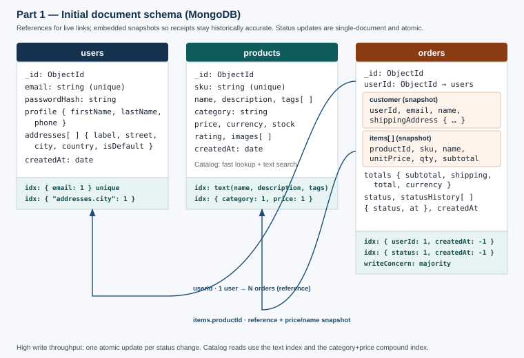
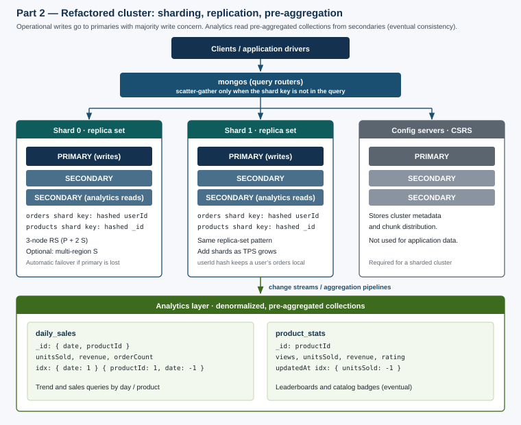

# E-commerce NoSQL Schema Design

GoMyCode checkpoint · NoSQL database design


This design uses a **MongoDB document model**. Products and orders have nested, variable structure; a single order document can hold the customer snapshot, line items, and status history, so a status change is one atomic write even at thousands of transactions per second. Text indexes cover catalog search. The three key entities are **users**, **products**, and **orders**.

The submission PDF is generated from `report.html` and should be uploaded alongside this repository.

- Initial schema diagram: [diagrams/part1-schema.svg](diagrams/part1-schema.svg)
- Refactored cluster diagram: [diagrams/part2-architecture.svg](diagrams/part2-architecture.svg)
- Sample documents: [`schemas/`](schemas/)

---

## Part 1 — Initial schema design

### Model, entities, and relationships

- **users** hold profile and address data. An order stores `userId` as a reference (one user, many orders).
- **products** are the browsable catalog. Frequent lookups and full-text search drive the index choices below.
- **orders** embed a *customer snapshot* and *item snapshots* (name, SKU, unit price at purchase). Receipts stay correct if a profile or catalog price later changes. `items.productId` remains a reference for inventory and links, but rendering an order does not join live product documents.
- **status** and **statusHistory** live on the same order document so delivery-status updates are atomic.



### Sample documents

`users` — see [schemas/part1-users.json](schemas/part1-users.json):

```json
{
  "_id": "u_8f21",
  "email": "aminata.diop@example.com",
  "passwordHash": "$2b$10$examplehash",
  "profile": {
    "firstName": "Aminata",
    "lastName": "Diop",
    "phone": "+221770000000"
  },
  "addresses": [
    {
      "label": "home",
      "street": "Rue 10, Médina",
      "city": "Dakar",
      "country": "SN",
      "isDefault": true
    }
  ],
  "createdAt": "2026-11-01T10:14:00Z"
}
```

`products` — see [schemas/part1-products.json](schemas/part1-products.json):

```json
{
  "_id": "p_shoe001",
  "sku": "SHOE-001",
  "name": "Running Sneakers",
  "description": "Lightweight road-running shoes",
  "category": "footwear",
  "tags": [
    "running",
    "sport",
    "unisex"
  ],
  "price": 45000,
  "currency": "XOF",
  "stock": 120,
  "rating": 4.5,
  "images": [
    "https://cdn.example.com/shoe-001.jpg"
  ],
  "createdAt": "2026-10-15T08:00:00Z"
}
```

`orders` — customer and items are snapshots; status changes are single-document updates. See [schemas/part1-orders.json](schemas/part1-orders.json):

```json
{
  "_id": "o_9c40",
  "userId": "u_8f21",
  "customer": {
    "userId": "u_8f21",
    "email": "aminata.diop@example.com",
    "name": "Aminata Diop",
    "shippingAddress": {
      "street": "Rue 10, Médina",
      "city": "Dakar",
      "country": "SN"
    }
  },
  "items": [
    {
      "productId": "p_shoe001",
      "sku": "SHOE-001",
      "name": "Running Sneakers",
      "unitPrice": 45000,
      "qty": 1,
      "subtotal": 45000
    }
  ],
  "totals": {
    "subtotal": 45000,
    "shipping": 2000,
    "total": 47000,
    "currency": "XOF"
  },
  "status": "paid",
  "statusHistory": [
    {
      "status": "created",
      "at": "2026-11-15T07:02:11Z"
    },
    {
      "status": "paid",
      "at": "2026-11-15T07:02:18Z"
    }
  ],
  "createdAt": "2026-11-15T07:02:11Z"
}
```

### Query patterns and indexes

| Query pattern | Collection | Index | Purpose |
|---|---|---|---|
| Log in / load account by email | users | `{ email: 1 }` unique | Fast, unique account lookup |
| Full-text product search | products | text index on `name`, `description`, `tags` | Catalog search at read time |
| Browse category and filter by price | products | `{ category: 1, price: 1 }` | Equality then range / sort |
| SKU lookup | products | `{ sku: 1 }` unique | Inventory and imports |
| Customer order history | orders | `{ userId: 1, createdAt: -1 }` | Recent orders for one user |
| Orders by delivery status | orders | `{ status: 1, createdAt: -1 }` | Operations / fulfillment views |

Full index definitions: [schemas/indexes-and-sharding.json](schemas/indexes-and-sharding.json).

**Scalability and consistency (Part 1).** High write throughput comes from keeping each checkout and each status transition as a single-document update: no multi-document transaction is required to move an order from `created` to `paid` or to append `statusHistory`. Status writes use `writeConcern: "majority"` so the new status is acknowledged by a replica-set majority before the client is told it succeeded. The catalog is read-heavy: the text index and the `category + price` compound index keep browse and search off collection scans. A single replica set is assumed at this stage; horizontal scale is introduced in Part 2.

---

## Part 2 — Refactored schema

New requirements are large-scale analytical queries on product trends and sales, plus high availability and partition tolerance as traffic grows. The document shapes from Part 1 are kept for operational data. The cluster is refactored with **sharding**, **replication**, and **denormalized pre-aggregates**.

- **Sharding.** `orders` are sharded on a hashed `userId` so one customer’s history stays on one shard (good for the history index). The alternative, a hashed `orderId` or `_id`, spreads writes more evenly if a few buyers dominate traffic, but turns history lookups into scatter-gather. `products` are sharded on a hashed `_id` to spread catalog load.
- **Replication.** Each shard is a 3-node replica set (primary + two secondaries), optionally with a multi-region secondary. The primary takes writes. Secondaries provide failover and analytical reads (`readPreference: "secondary"`). Config servers have their own replica set. Applications connect through `mongos`.
- **Denormalization.** `daily_sales` and `product_stats` store pre-aggregated metrics so trend queries do not scan raw orders. They are maintained by change streams and aggregation pipelines, not by the checkout write path. Analytics can also run on a dedicated analytical node.



### Pre-aggregated sample documents

`daily_sales` — see [schemas/part2-daily_sales.json](schemas/part2-daily_sales.json):

```json
{
  "_id": {
    "date": "2026-11-15",
    "productId": "p_shoe001"
  },
  "unitsSold": 86,
  "revenue": 3870000,
  "orderCount": 79,
  "currency": "XOF"
}
```

`product_stats` — see [schemas/part2-product_stats.json](schemas/part2-product_stats.json):

```json
{
  "_id": "p_shoe001",
  "views": 15240,
  "unitsSold": 1287,
  "revenue": 57915000,
  "rating": 4.5,
  "updatedAt": "2026-11-15T07:30:00Z"
}
```

### Strategies, indexes, and trade-offs

| Strategy | How it is applied | Trade-off |
|---|---|---|
| Sharding | orders: hashed `userId`; products: hashed `_id`; scale out by adding shards | Higher write throughput and data volume; hashed `userId` can hotspot heavy buyers; history stays local to a shard |
| Replication | 3-node replica set per shard (P + 2 S); optional multi-region secondaries; `mongos` + config RS | High availability and automatic failover; secondaries may lag; partition tolerance via distributed replica sets |
| Denormalization | `daily_sales` (`date + productId`) and `product_stats` (views, unitsSold, revenue, rating), updated asynchronously | Fast trend/sales queries; analytics are eventually consistent and slightly stale |
| Read preference | Primary for checkout and order status; secondary (or a dedicated analytical node) for reports | Heavy aggregations do not compete with checkout on the primary |
| Indexes (new) | `daily_sales`: `{ date: 1 }`, `{ productId: 1, date: -1 }`; `product_stats`: `{ unitsSold: -1 }`, `{ revenue: -1 }` | Support day-range, per-product trends, and leaderboards without scanning orders |

**CAP trade-off.** Order status stays *strongly consistent*: single-document atomic updates with `writeConcern: "majority"` on the primary. The product catalog and the analytics collections may be *eventually consistent* (secondary reads, asynchronous pre-aggregation). That split keeps checkout correct while giving the system high availability and partition tolerance under growth.

---

## Short reflection report (294 words)

Refactoring the schema while preserving checkout correctness was the hardest part of this exercise. Part 1 relied on single-document atomic updates and majority write concern so that order status could not diverge mid-payment. Introducing shards and replica sets does not remove that need, but it adds new failure modes. A poorly chosen shard key can create hotspots, or turn a frequent query into a scatter-gather operation. I considered hashing on orderId, which balances writes evenly, and hashing on userId, which keeps a customer's orders on one shard for history lookups. I chose a hashed userId for orders, accepting some risk of uneven load from heavy buyers, and a hashed _id for products so catalog traffic is spread evenly. Another challenge was analytics freshness. Pre-aggregated collections such as daily_sales and product_stats cannot be updated in the same atomic write as the order without slowing checkout. Change streams and scheduled aggregation pipelines therefore update those collections asynchronously, so dashboards lag slightly behind live sales.

The new requirements forced a shift from a single-cluster document design to a distributed architecture. High availability and partition tolerance required a replica set of three nodes on each shard, with the primary taking writes and secondaries providing failover and analytical reads. Large-scale trend queries could not run against the raw orders collection without competing with thousands of transactions per second, so denormalization became essential.

The refactor improves scalability by spreading data and write load across shards, and availability through automatic failover inside each replica set. Query performance improves because operational traffic still uses targeted indexes, while product-trend and sales reports read compact pre-aggregated documents from secondaries or a dedicated analytical node. The CAP trade-off is explicit: analytics and the product catalog may be eventually consistent, but order status remains strongly consistent.
